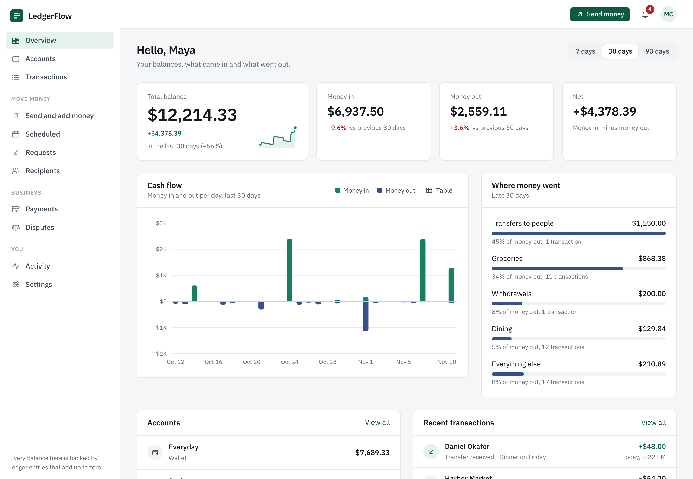
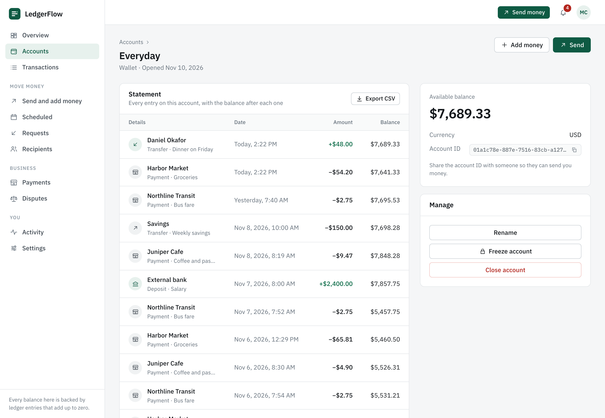
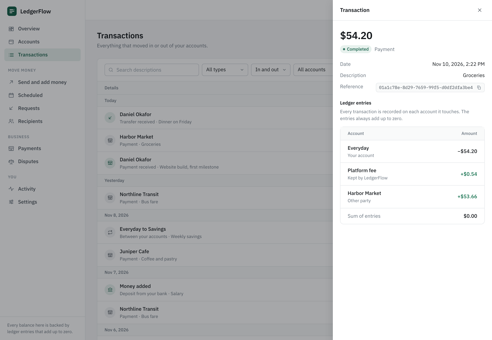
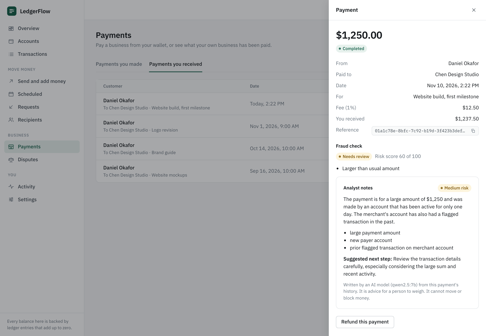
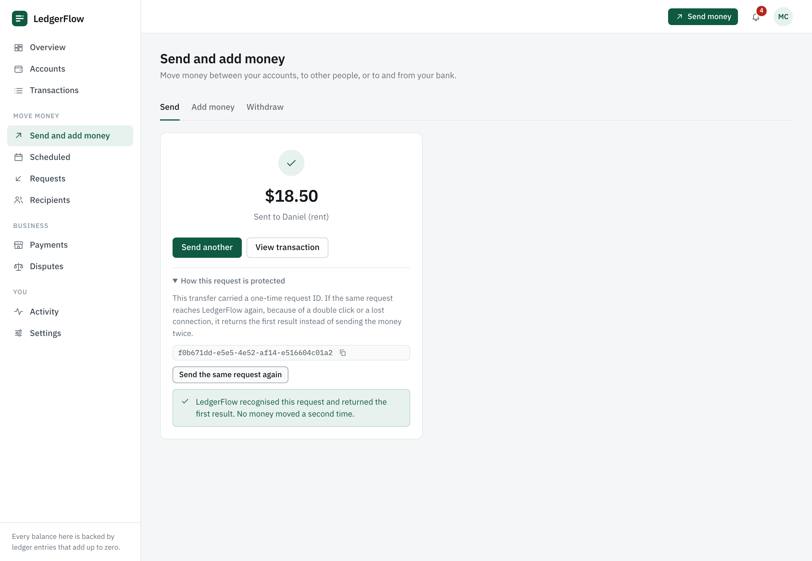

# LedgerFlow

[](https://github.com/Divya1S/LedgerFlow/actions/workflows/ci.yml)


A digital wallet and payments app where every balance can be proven.

Hold money in wallets, send it to people, pay businesses, and see where it
went. Behind every number on the screen is a record you can open and check.



## What you can do

**Hold and move money**

- Open as many wallets as you like and see all balances in one place.
- Send money to a friend. LedgerFlow shows you their name before you send.
- Save the people you pay often, so you pick a name instead of typing an ID.
- Schedule a transfer for a date, or repeat it every week or month.
- Ask someone for money with a link they can pay in two clicks.

**Pay and get paid**

- Pay a business from your wallet and get a refund if something goes wrong.
- Open a dispute when a payment was not what you agreed to.
- Run your own business account, see who paid you, and refund in full or in part.
- Every payment you receive is checked for fraud. Risky ones can come with
  a short written explanation from an optional AI helper.

**Stay in control**

- See money in, money out and spending by category for the last 7, 30 or 90 days.
- Search and filter every transaction.
- Download a statement as a spreadsheet.
- Freeze a wallet in one click. Money can still arrive, nothing can leave.
- Get notified when you are paid, refunded or need to act.
- Review a full history of sign-ins and changes on your profile.

## Why you can trust the numbers

**Every movement is written down twice.** Money leaving one account and
arriving in another are two entries that must cancel out. If they do not,
the database refuses to save them. Open any transaction to see its entries.

**A request is never applied twice.** A double click or a dropped
connection cannot send the same money a second time. The receipt after
each transfer lets you try it.

**It keeps working when parts fail.** In an earlier two minute test with
the message queue stopped and the cache frozen, 102,110 requests were made
and none failed.

**It holds up under pressure.** When 1,000 transfers were fired at one
account at the same moment, exactly the ones the balance could afford went
through, and the books were still exact afterwards.

## A look around

| | |
|---|---|
|  |  |
| **Statements.** Every entry, with the balance after each one. | **Proof.** The entries behind a payment always add up to zero. |
|  |  |
| **Fraud check.** A flagged payment, with the reasons in plain words. | **Safe to retry.** The same request sent twice moves money once. |

## Try it

You need [Docker](https://www.docker.com/products/docker-desktop/) and Java 21.

```bash
docker compose up -d                              # start the database and its helpers
mvn -Pwith-ui package -DskipTests                 # build the app
java -jar target/ledgerflow-0.1.0-SNAPSHOT.jar    # run it
```

In a second terminal, add some demo data:

```bash
./scripts/seed-demo.sh
```

Then open <http://localhost:8080> and sign in:

| | |
|---|---|
| Email | `maya@demo.ledgerflow.io` |
| Password | `demo-password-123` |

Maya has three wallets, a small design business and eleven weeks of
history. Sign in as `daniel@demo.ledgerflow.io` in a private window to see
the other side of her transfers. You can also create your own profile from
the sign-in page.

All money here is pretend. Nothing connects to a real bank.

## How it is built

| Part | What it does | Built with |
|---|---|---|
| Dashboard | The screens you see | React, TypeScript |
| Server | Checks every request and applies the rules | Java, Spring Boot |
| Database | The one place the truth about money lives | PostgreSQL |
| Message queue | Passes on news of each payment, for alerts and fraud checks | Kafka |
| Cache | Makes repeat views fast. Never trusted for balances | Redis |
| Fraud notes | Writes the explanation for flagged payments | A local AI model, optional |

## Learn more

For the detail behind the claims on this page:

- [Engineering overview](docs/engineering-overview.md): how it is put together, with measurements
- [Product features](docs/product-features.md): each feature and the rule it keeps
- [Database design](docs/database-design.md)
- [What happens when things fail](docs/failure-handling.md)
- [Security](docs/security.md)
- [The AI fraud notes](docs/ai-fraud-copilot.md)
- [Design decisions](docs/decisions/)

## Not included yet

Shared team accounts with approvals, two-step sign-in, more than one
currency, and spending limits. The reasons are in
[product features](docs/product-features.md#not-built-and-why).

## License

[MIT](LICENSE)
